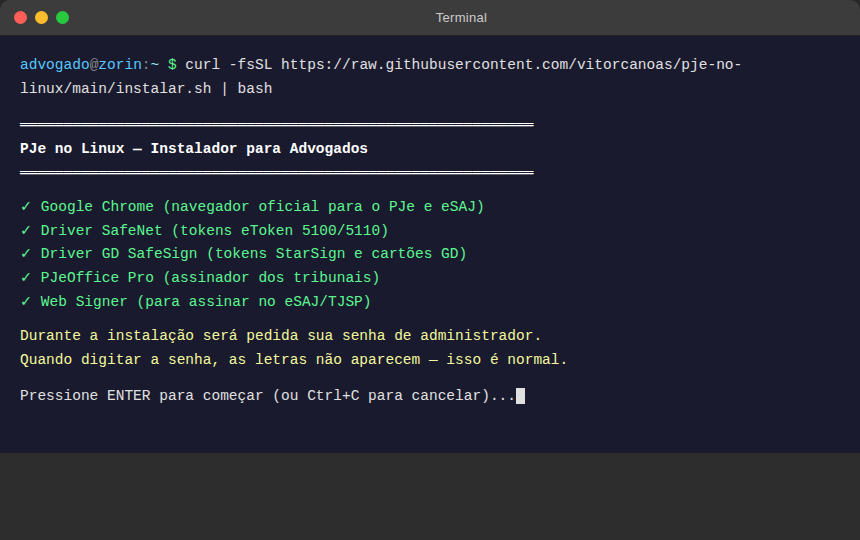
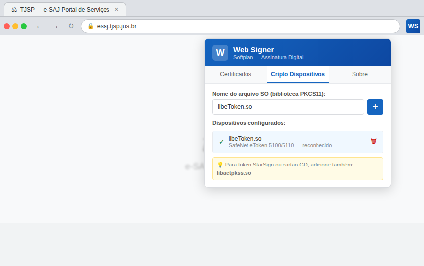
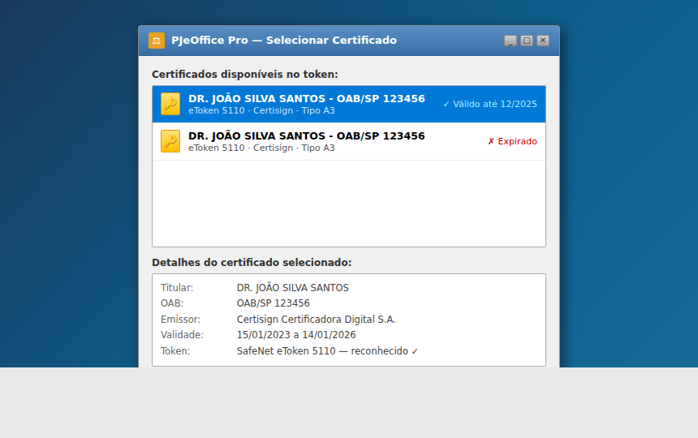
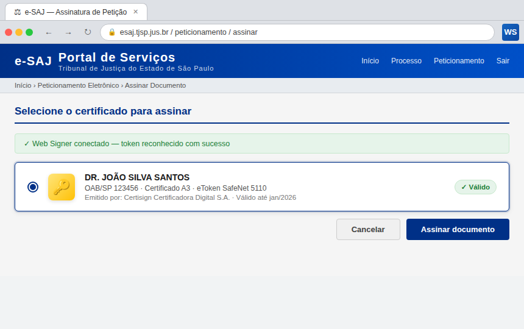

# PJe on Linux

> README em português: [README.md](README.md)

---

## Which script do I run?

This repository covers **two distro families**, each with its own installer:

| Your distro | Run | Full guide |
|---|---|---|
| Ubuntu, Zorin OS, Linux Mint, Debian | `bash instalar.sh` | [docs/ubuntu/](docs/ubuntu/README.md) (pt-BR) |
| Arch Linux, **Omarchy**, EndeavourOS, Manjaro, CachyOS | `bash instalar-arch.sh` | [docs/arch/](docs/arch/README.md) (pt-BR) |

Not sure which one you have? Run `cat /etc/os-release` in the Terminal — the `ID` or `ID_LIKE` field shows the family. **Ran the wrong one? The script tells you which one is right — nothing breaks.**

Each guide above is the full step-by-step for that path, including a **Validação** (Validation) section with commands you run yourself to confirm the install worked. The guides are kept in Brazilian Portuguese only — the target audience is Brazilian lawyers, and this English README stays complete on its own rather than duplicating them. The step-by-step below is for **Ubuntu/Zorin/Mint/Debian**; for Arch/Omarchy, skip straight to the [Arch Linux / Omarchy](#arch-linux--omarchy) section.

Changes between versions — including any version or hash change of the proprietary components — are recorded in **[CHANGELOG.md](CHANGELOG.md)**.

---

## Install (Ubuntu/Zorin/Mint/Debian) — copy, paste and press Enter

```bash
git clone https://github.com/vitorcanoas/pje-no-linux.git && cd pje-no-linux && bash instalar.sh
```

> Open the Terminal (`Ctrl + Alt + T`), paste with `Ctrl + Shift + V` and press Enter.
> Don't know what a Terminal is? Read the step-by-step guide with images below. 👇

---

## Just installed Linux and can't get PJe to work?

Relax. This guide was made **by a lawyer, for lawyers** — including those who have never touched Linux in their lives.

One single command installs everything. No tech knowledge required.

---

## What this script installs for you

| What | What it's for |
|---|---|
| **Google Chrome** | Official PJe browser |
| **SafeNet SAC** | Makes your computer recognize your digital token (the certificate USB stick) |
| **SafeSign IC** | Signs documents with your A3 certificate |
| **PJeOffice Pro** | The official court digital signing tool |
| **Web Signer** | Extension for signing in the browser (eSAJ, TJSP and others) |
| **Antigravity IDE** | Recommended work environment |
| **Microsoft 365** | Word, Excel, PowerPoint and Outlook running on Linux |

It also configures the **Super+Shift+S** shortcut for area screenshots — same as Win+Shift+S on Windows.

---

## How to install — step by step, from scratch

### Step 1 — Open the Terminal

**The Terminal is Linux's "Command Prompt".** It's a window where you type instructions — it looks scary, but you'll only use one command.

To open it:
- Press **Ctrl + Alt + T** at the same time
- Or search for **"Terminal"** in your apps (like the Start Menu)



---

### Step 2 — Type the command

With the Terminal open, **click once inside the black window** and type exactly:

```
bash instalar.sh
```

Then press **Enter**.

> **Tip:** You can copy the text above and paste it into the Terminal with **Ctrl + Shift + V** (on Linux it's Shift+V, not just V).

---

### Step 3 — Enter your password

The installer will ask for your user password (the same one you use to log into the computer).

**⚠️ Important:** When you type your password, **the characters do NOT appear on screen** — no asterisks, nothing. It looks like it's not working, but it is. This is normal Linux security. Just type your password and press Enter.

---

### Step 4 — Confirm the installation

A summary will appear showing what will be installed. Read it and, if you agree, **press the letter `s`** and then **Enter** to confirm.

---

### Step 5 — Wait

The installer will download and install everything on its own. Depending on your internet speed, it takes 5 to 15 minutes. You'll see text scrolling on screen — that's normal, just let it run.

At the end, a report like this appears:

```
✓ Google Chrome        installed
✓ SafeNet SAC          installed
✓ SafeSign IC          installed
✓ PJeOffice Pro        installed
✓ Web Signer           installed
✓ Microsoft 365 PWA    configured
✓ Super+Shift+S        configured
```

---

### Step 6 — Configure Web Signer (one time only)

After installing, open **Chrome** and do this configuration **just once**:

1. Click the **Web Signer** icon in Chrome's toolbar (a blue shield)
2. Click **Settings** (gear icon)
3. Click the **"Crypto Devices"** tab
4. In the **"SO file name"** field, type: `libeToken.so`
5. Click the **+** button



---

## When everything is working

**PJeOffice recognizing your token:**



**eSAJ with your certificate available:**



**Want to check without opening a real case file?**
**[TESTE-RAPIDO.md](TESTE-RAPIDO.md)** (in Portuguese) walks through a 4-command
check that tells you, in about a minute, whether the reader, the token, the
middleware and PJeOffice are all up — and what to do when each one fails.

---

## Something went wrong?

Don't panic. The installer saves a full log of everything that happened to:

```
~/pje-install-DATE-TIME.log
```

Send that file to support and they'll have everything they need to help you.

> ⚠️ **Before attaching the log somewhere public** (a GitHub issue, a forum, a
> WhatsApp group): it records your token's **chip ATR** — a fixed identifier for
> your device — along with your username and machine paths. The log **never
> contains the PIN or the private key**, but the ATR allows records to be
> correlated. Review the file before publishing it, or send it only through a
> private support channel.

---

## Day-to-day tips on Linux

See [DICAS.md](DICAS.md) (Portuguese) to learn:

- **Super+Shift+S** — area screenshot (same as Win+Shift+S)
- Keyboard shortcuts equivalent to Windows
- Clipboard history (same as Win+V)
- How to print to PDF
- How to recover deleted files
- How to use the digital token

---

## Arch Linux / Omarchy

If you're on **Arch Linux, Omarchy, EndeavourOS, Manjaro, or CachyOS**, there's a separate installer: `instalar-arch.sh`. It uses the **AUR** (Arch User Repository) instead of manually downloading `.deb`/zip files.

### Prerequisites

- `x86_64` architecture
- The **`base-devel`** group (compiler and build tools, needed to build AUR packages)
- An **AUR helper**: `yay` or `paru`

If you don't have `yay` installed yet:

```bash
sudo pacman -S --needed git base-devel
git clone https://aur.archlinux.org/yay.git /tmp/yay
cd /tmp/yay && makepkg -si
```

### Install

```bash
git clone https://github.com/vitorcanoas/pje-no-linux.git && cd pje-no-linux && bash instalar-arch.sh
```

The script detects your AUR helper (`yay` or `paru`), shows a summary of what it will install, and asks for confirmation before compiling anything. During installation, the AUR helper shows the **PKGBUILD** for each proprietary package before building it — it's worth reading.

### Uninstall

```bash
bash desinstalar-arch.sh
```

Removes the AUR packages, config files, shortcuts, and Native Messaging Hosts. It asks separately before removing generic infrastructure packages (`pcsclite`, `ccid`, `opensc`, `p11-kit`) and personal data in `~/.pjeoffice-pro/`, since other programs on the machine may depend on them.

### Debian ↔ Arch equivalence table

| Component | Ubuntu/Debian | Arch (AUR) |
|---|---|---|
| PJeOffice Pro | portable zip v2.5.16u → `/opt` | `pje-office 2.5.16u-8` |
| Web Signer | `.deb` 2.12.1 | `softplan-websigner 2.15.0.1-2` |
| SafeNet SAC | zip 10.8.1050 (via GlobalSign) | `sac-core` + `sac-gui 10.9.6885-1` |
| Google Chrome | apt repo + GPG key | `google-chrome` (AUR) |
| Base PKCS#11 | libs via apt | `pcsclite`, `ccid`, `opensc`, `p11-kit` (official repository) |
| Shodo (Labor Court) | not covered | `shodo` (AUR, optional) |

Data measured on 09/09/2026 via the AUR API.

On Arch there's no manual download with a pinned SHA256 check like in `instalar.sh`: the AUR already packages each component, and integrity checking becomes the **PKGBUILD review** that the helper (`yay`/`paru`) shows before building.

### Certificate security

`instalar-arch.sh` **never asks for or stores the PIN** of your A3 certificate — not in a script, not in a config file, not in an environment variable.

The reason is concrete: in the PKCS#11 standard (the protocol the token uses), *authenticating* and *signing* run in the **same session**, unlocked by the **same PIN** — the difference between the two operations is just a key-usage flag. In other words, whoever has your PIN and the token plugged in can sign a legal filing in your name, with full legal effect. That's why the PIN must never circulate outside the moment it's used.

The token check the script runs (`pkcs11-tool --list-slots` and `pkcs11-tool --list-objects --type cert`) only reads **public objects** on the token — it doesn't ask for the PIN and doesn't unlock the private key. The PIN should only ever be typed by the certificate holder, at the moment of use, in the signing tool's own window (PJeOffice, Web Signer, etc.).

### I have SEVERAL certificates on the token. Is that normal?

**Yes, it is.** Every time you **renew** your certificate, the Certificate
Authority writes a **new one** onto the token — and the **old one stays there**.
A lawyer who has renewed twice typically has three certificates on the same
token, all bearing the same name.

Only the **valid** one works. The expired ones don't disappear on their own and
do no harm, but they cause two classic mix-ups:

1. **In the browser**, when picking a certificate, several show up with the same
   name. Pick an expired one and PJe/e-SAJ refuses the login — usually
   **without saying why**.
2. **Checking from the terminal**, anyone who looks only at the first entry
   concludes the certificate has expired and renews it needlessly. The listing
   order is **not** chronological.

To see them all, with each one's real validity period:

```bash
bash lib/detectar-certificado.sh
```

The output marks `✔ VÁLIDO` on the one currently in force and `✘ vencido` on the
rest — and skips the ICP-Brasil chain certificates (Root, ITI, AC), which live on
the token but are **not** your signing certificate. The command **never asks for
a PIN**: it reads public objects only.

> The dates shown in the certificate's *name* are just free text written by the
> CA. The script doesn't trust them: it reads the `notBefore`/`notAfter` fields
> from inside the certificate itself, which is the validity PJe actually checks.

If **none** shows up as valid, then the certificate really has expired: you must
**renew it with your Certificate Authority**. No configuration in this repository
can work around that.

### Is your certificate A1 or A3? (the difference changes everything)

Before fighting with tokens, readers and drivers, check **which of the two** you
have — half the reported problems are people with an A1 trying to solve an A3
problem.

| | **A1** | **A3** |
|---|---|---|
| What it is | A **file** (`.pfx` or `.p12`) | A **USB token** or smartcard + reader |
| Where it lives | On the computer's disk | Inside the chip, and never leaves it |
| Typical validity | 1 year | 3 years |
| Needs a driver? | **No** | **Yes** (PKCS#11 middleware) |

**If your certificate is A1**, there is no token to plug in, and **nothing in
this Arch/Omarchy section applies to you**: don't install SafeNet SAC, don't
worry about `pcscd`, readers or `libeToken.so`. An A1 is imported directly:

- **In PJeOffice Pro**: open PJeOffice, go to *Certificates* → *Import*, and pick
  your `.pfx`/`.p12` file.
- **In Chrome**: `chrome://settings/certificates` → *Your certificates* tab →
  **Import** → select the `.pfx`/`.p12` and enter the file's password.

Keep the A1 file safe: whoever has the file **and** its password can sign in your
name, with full legal effect. Don't leave it in a cloud-synced folder, and don't
send it over e-mail or WhatsApp.

**If your certificate is A3** (USB token — the common case in legal practice),
follow this section normally. The diagnostic
`bash lib/detectar-certificado.sh` identifies your token model and tells you
exactly which package to install.

### Desktop environment: GNOME vs. Hyprland

The rest of this repository assumes **GNOME** (shortcuts via `gsettings`, GNOME-style autostart). Omarchy uses **Hyprland/Wayland**, which is different:

- **PJeOffice autostart**: `instalar-arch.sh` writes a `.desktop` file to `~/.config/autostart/`, which is the standard **XDG autostart** location — Hyprland also reads that directory, so it works with no extra configuration (confirmed: `xdg-desktop-autostart.target` is `active` on Omarchy). If for some reason it doesn't launch and you're on Omarchy, the idiomatic fallback is **not** `exec-once` in `hyprland.conf` (Omarchy's Hyprland config is Lua) — it's adding this to `~/.config/hypr/autostart.lua`:
  ```lua
  o.launch_on_start("/path/to/pjeoffice-pro")
  ```
- **Screenshot shortcut**: `instalar.sh` configures `Super+Shift+S` via `gsettings` (GNOME). This **doesn't apply to Omarchy**, which already ships with its own screenshot shortcut configured — `instalar-arch.sh` doesn't touch it.

### Manual step: Web Signer extension in Chrome

`instalar-arch.sh` installs Chrome and the Web Signer native package, but **doesn't install the browser extension** — that has to be done manually, once:

1. Open Chrome and go to: https://chromewebstore.google.com/detail/web-signer/bbafmabaelnnkondpfpjmdklbmfnbmol
2. Click **Add to Chrome**
3. Then follow [Step 6](#step-6--configure-web-signer-one-time-only) in this README to configure the "SO file name" (`libeToken.so`)

> **Erratum (09/2026):** earlier versions of this repository listed the ID
> `dcngeagmmhegagicpcmpinaoklddcgon`. That ID is **not** Web Signer — it is the
> *Web PKI* extension by Lacuna Software, a different product that does **not**
> talk to Softplan's signer. If you installed that extension and your
> certificate never showed up in e-SAJ/PJe, that was the cause: **uninstall it**
> and install the one linked above.
>
> The proof of the correct ID is Softplan's own official package: the Native
> Messaging Host `manifest.json` declares
> `"allowed_origins": ["chrome-extension://bbafmabaelnnkondpfpjmdklbmfnbmol/"]`
> — that is the only ID the native component accepts.

---

## About the author

I'm **Vitor**, a lawyer for over 10 years, passionate about technology and currently learning to code — because apparently law alone isn't complicated enough.

I switched to Linux and spent hours trying to get PJe to work. After a lot of suffering (and a few words that don't belong in a README), I put everything into a script so no other lawyer has to go through the same thing.

After all, **who hasn't struggled with technology on a daily basis?** 😄

If I figured it out, you can too.

---

## For the Tech-Savvy Lawyer (and Developers)

> This section covers the **Ubuntu/Debian** installer (`instalar.sh`) in detail. For details on the Arch installer (`instalar-arch.sh`), see the [Arch Linux / Omarchy](#arch-linux--omarchy) section above.

### Project structure

```
instalar.sh              # Main script (Ubuntu/Debian) — installs all components
desinstalar.sh           # Removes everything instalar.sh installed
instalar-arch.sh         # Main script (Arch/Omarchy) — installs via AUR
desinstalar-arch.sh      # Removes everything instalar-arch.sh installed
lib/
  detectar-certificado.sh  # A3 token diagnostic: identifies the model from the
                           # ATR and says which middleware to install. Never
                           # asks for a PIN. Runs standalone:
                           # bash lib/detectar-certificado.sh
TESTE-RAPIDO.md          # How to verify the install worked, without a real case
DICAS.md                 # Usage guide for lawyers migrating from Windows
atualizar-hashes.sh      # [Debian/Ubuntu ONLY] Recomputes instalar.sh hashes
checksums.sha256         # [Debian/Ubuntu ONLY] SHA256 hashes of downloaded binaries
assets/
  icons/               # 128×128 PNG icons for Microsoft 365 PWAs
                       # (not versioned — shortcuts fall back to the Chrome icon)
  screenshots/         # Illustrative screenshots for the README
  dicas/               # Images for the DICAS.md guide
```

### Security

> **Note:** `checksums.sha256` and `atualizar-hashes.sh` belong **exclusively to
> the Debian/Ubuntu flow** (`instalar.sh`), which downloads binaries straight
> from the vendor. On Arch/Omarchy there is no manual download: packages come
> from the AUR and integrity is verified by each package's PKGBUILD, which the
> helper (`yay`/`paru`) shows you to review before compiling.

Every downloaded binary is verified with **SHA256** before installation. If the hash doesn't match, the installation aborts. Hashes are stored in the `CONFIG` block at the top of `instalar.sh` and must be updated by the maintainer when bumping versions.

```bash
sha256sum filename.deb
```

### How to uninstall

**Ubuntu / Zorin / Mint / Debian:**

```bash
bash desinstalar.sh
```

**Arch Linux / Omarchy:**

```bash
bash desinstalar-arch.sh
```

Removes all packages, config files, shortcuts, and reverts the screenshot
keyboard shortcut. The Arch version also removes the polkit rule
`/etc/polkit-1/rules.d/50-pcscd-pje.rules` created by the installer. Both are
interactive and confirm before removing anything.

### Components and current versions

| Component | Version | Distribution |
|---|---|---|
| SafeNet SAC | 10.8.1050 | Ubuntu 22.04 |
| SafeSign IC | 4.6.0.0 | Ubuntu 22.04 |
| PJeOffice Pro | v2.5.16u | Linux x64 |
| Web Signer | 2.12.1 | Chrome (64-bit .deb) |

### System requirements

- Ubuntu 22.04 / 24.04, Zorin OS 17/18, Linux Mint 21–22, or Debian 12+
- Architecture: `amd64` (64-bit)
- Bash 5.0+
- Internet connection
- `sudo` available

### Contributing

The project uses **SpecKit** as its specification methodology. See [AGENTS.md](AGENTS.md) for the command workflow and how to contribute new features.

```bash
# Check code quality
shellcheck --severity=warning instalar.sh
shellcheck --severity=warning desinstalar.sh
bash -n instalar.sh
```

---

*Open source project licensed under [GPL-3.0](LICENSE). Use it, improve it, share it — but keep it open.*
