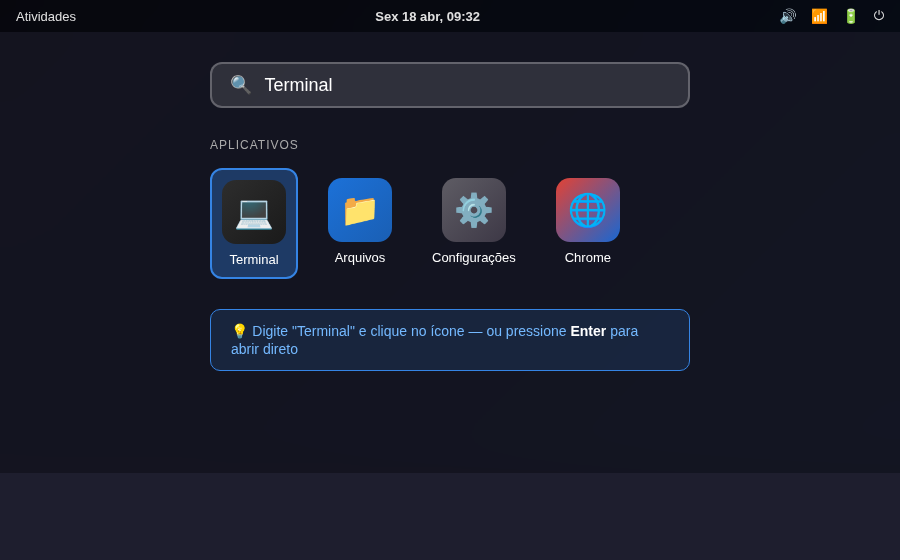
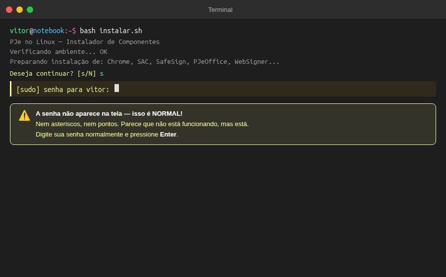
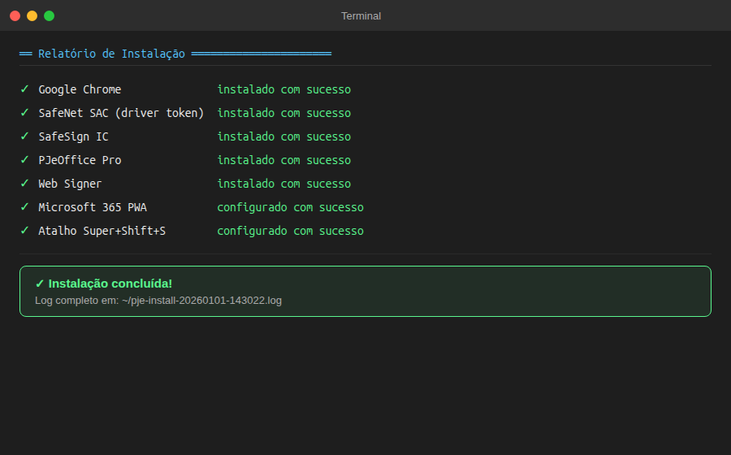
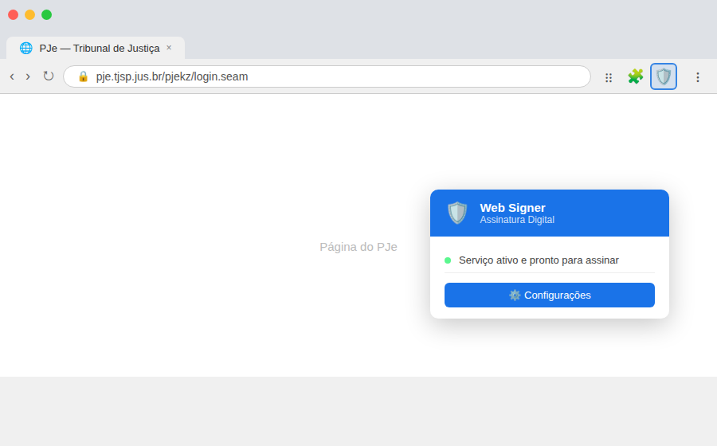

# PJe no Linux

> README em inglês: [README.en.md](README.en.md)

---

## Qual script eu rodo?

Este repositório cobre duas "famílias" do Linux (cada uma tem seu jeito de instalar programas) — identifique a sua na tabela:

| Sua distro | Rode | Guia completo |
|---|---|---|
| Ubuntu, Zorin OS, Linux Mint, Debian | `bash instalar.sh` | [docs/ubuntu/](docs/ubuntu/README.md) |
| Arch Linux, **Omarchy**, EndeavourOS, Manjaro, CachyOS | `bash instalar-arch.sh` | [docs/arch/](docs/arch/README.md) |

Se não sabe qual é a sua, rode `cat /etc/os-release` no Terminal — o campo `ID` ou `ID_LIKE` mostra a família. **Rodou o errado? O script avisa e diz qual é o certo — não quebra nada.**

Cada guia acima é o passo a passo completo daquele caminho, com uma seção **Validação** de comandos que você mesmo roda para conferir que deu certo. O restante deste README é a versão resumida: o passo a passo abaixo é para **Ubuntu/Zorin/Mint/Debian**; para Arch/Omarchy, pule direto para a seção [Arch Linux / Omarchy](#arch-linux--omarchy).

**Já instalou e algo não funciona?** Vá direto para o **[TESTE-RAPIDO.md](TESTE-RAPIDO.md)** — diagnóstico em cascata, do leitor até o site do tribunal.

Mudanças entre versões (inclusive troca de versão ou hash dos componentes proprietários) ficam em **[CHANGELOG.md](CHANGELOG.md)**.

---

## Instalação (Ubuntu/Zorin/Mint/Debian) — copie, cole e pressione Enter

```bash
git clone https://github.com/vitorcanoas/pje-no-linux.git && cd pje-no-linux && bash instalar.sh
```

> Abra o Terminal (`Ctrl + Alt + T`), cole o comando acima com `Ctrl + Shift + V` e pressione Enter.
> Não sabe o que é Terminal? Leia o passo a passo com imagens abaixo. 👇

---

## Você é advogado, migrou pro Linux e agora o PJe não funciona?

Bem-vindo ao clube. Sofremos muito e o café já não resolve mais.

Passei horas nisso. Horas. Com palavrão, com raiva, com aquela cara de quem perdeu prazo — mas era só o driver do token que não funcionava. Depois de muito sofrimento transformado em código, ficou pronto:

**Um único comando instala tudo.**

E o melhor: leva de 5 a 15 minutos pra rodar. Tempo perfeito pra colocar uma balada anos 2000 no Spotify e fingir que você está sendo produtivo enquanto o Linux trabalha por você.

Ou um rock pauleira se preferir. O script não julga. O Eiffel 65 e o Metallica têm o mesmo peso aqui. 🤘🎵

Feito por um advogado, para advogados — inclusive para quem nunca tocou em Linux na vida. Sem precisar entender de tecnologia.

---

## O que esse script instala para você

| O que | Para que serve |
|---|---|
| **Google Chrome** | Navegador oficial do PJe |
| **SafeNet SAC** | Para o computador reconhecer seu token (aquele pendrive do certificado) |
| **SafeSign IC** | Para assinar documentos com seu certificado A3 |
| **PJeOffice Pro** | O assinador digital oficial dos tribunais |
| **Web Signer** | Extensão para assinar no navegador (eSAJ, TJSP e outros) |
| **Antigravity IDE** | Ambiente de trabalho recomendado |
| **Microsoft 365** | Word, Excel, PowerPoint e Outlook funcionando no Linux |

E ainda configura o atalho **Super+Shift+S** para captura de tela — igual ao Win+Shift+S que você usava no Windows.

> ⚠️ **Depois do script rodar, falta um passo manual único:** instalar a extensão
> Web Signer na loja do Chrome ([Passo 6](#passo-6--configurar-o-web-signer-uma-vez-só)
> abaixo). O script **não** faz isso sozinho — sem essa extensão, o e-SAJ e o PJe
> não enxergam o seu certificado.

### O que o instalador vai te perguntar

Ele **para e espera resposta** em alguns pontos. Nenhuma resposta é definitiva —
dá para rodar o script de novo depois. Prepare estas:

| Pergunta | O que responder |
|---|---|
| *"Deseja continuar?"* (resumo do que será instalado) | `s` para seguir. |
| *"Conecte o token USB AGORA e pressione Enter"* | Plugue o token e dê Enter — é assim que o script descobre o modelo e escolhe o driver certo. **Se o seu certificado é A1** (arquivo `.pfx`/`.p12`, sem token), apenas pressione Enter. |
| *"Iniciar o PJeOffice Pro automaticamente ao ligar o computador?"* | `s` se você usa PJe todo dia (evita esquecer de abrir antes de logar); `n` ou Enter se prefere abrir na mão. |

---

## Como instalar — do zero, passo a passo

### Passo 1 — Abrir o Terminal

**O Terminal é o "Prompt de Comando" do Linux.** É uma janela onde você digita instruções para o computador — parece assustador, mas você vai usar só um comando.

Para abrir:
- Pressione **Ctrl + Alt + T** ao mesmo tempo
- Ou clique em **Atividades** (canto superior esquerdo) → digita **"Terminal"** → clica no ícone



Com o Terminal aberto, você verá uma janela preta. É aqui que você vai digitar o comando:


---

### Passo 2 — Digitar o comando

Com o Terminal aberto, **clique uma vez dentro da janela preta** e digite exatamente isso:

```
bash instalar.sh
```

Depois pressione **Enter**.

> **Dica:** Você pode copiar o texto acima e colar no Terminal com **Ctrl + Shift + V** (no Linux é Shift+V, não só V).

---

### Passo 3 — Digitar sua senha

O instalador vai pedir sua senha de usuário (a mesma que você usa para entrar no computador).

**⚠️ Importante:** Quando você digitar a senha, **as letras NÃO aparecem na tela** — nem asteriscos, nada. Parece que não está funcionando, mas está. É uma proteção normal do Linux. Digite a senha e pressione Enter.



---

### Passo 4 — Confirmar a instalação

Vai aparecer um resumo mostrando o que será instalado. Leia e, se estiver de acordo, **pressione a letra `s`** e depois **Enter** para confirmar.

---

### Passo 5 — Aguardar

O instalador vai baixar e instalar tudo sozinho. Dependendo da sua internet, leva de 5 a 15 minutos. Você vai ver textos passando na tela — isso é normal, pode deixar rodar.

No final, aparece um relatório como este — tudo com ✓ verde significa que deu certo:



---

### Passo 6 — Configurar o Web Signer (uma vez só)

Depois de instalar, abra o **Chrome** e faça essa configuração **uma única vez**:

1. Procure o ícone do **Web Signer** na barra do Chrome (um escudo 🛡️ no canto superior direito) e clique nele



2. Clique em **Configurações** (ícone de engrenagem)
3. Clique na aba **"Cripto Dispositivos"**
4. No campo **"Nome do arquivo SO"**, digite: `libeToken.so`
5. Clique no botão **+**


---

## Quando tudo estiver funcionando

**PJeOffice reconhecendo seu token:**


**eSAJ com seu certificado disponível:**


**Quer conferir sem abrir um processo de verdade?** O
**[TESTE-RAPIDO.md](TESTE-RAPIDO.md)** traz uma checagem de 4 comandos que diz,
em um minuto, se o leitor, o token, o *middleware* (o programa que faz a ponte
entre o token e o computador) e o PJeOffice estão de pé — e o
que fazer quando cada um falha.

---

## Algo deu errado?

Não entre em pânico. O instalador grava um log completo com tudo que aconteceu em:

```
~/pje-install-DATA-HORA.log
```

Envie esse arquivo para o suporte e ele terá tudo que precisa para te ajudar.

> ⚠️ **Antes de anexar o log em um lugar público** (issue no GitHub, fórum,
> grupo de WhatsApp): ele registra o **ATR do chip** do seu token — um
> identificador fixo do seu dispositivo — além do nome de usuário e caminhos da
> sua máquina. O log **nunca contém o PIN nem a chave privada**, mas o ATR
> permite correlacionar registros. Revise o arquivo antes de publicá-lo, ou
> envie-o apenas em canal privado de suporte.

---

## Dicas para o dia a dia no Linux

Consulte o [DICAS.md](DICAS.md) para aprender:

- **Super+Shift+S** — captura de área da tela (igual ao Win+Shift+S)
- Atalhos do teclado equivalentes ao Windows
- Histórico da área de transferência (igual ao Win+V)
- Como imprimir para PDF
- Como recuperar arquivos deletados
- Como usar o token digital

---

## Arch Linux / Omarchy

Se você usa **Arch Linux, Omarchy, EndeavourOS, Manjaro ou CachyOS**, o instalador é outro: `instalar-arch.sh`. Ele usa o **AUR** (Arch User Repository) em vez de baixar `.deb`/zip manualmente — o AUR é *um repositório de programas mantido pela comunidade, fora do catálogo oficial* da distribuição.

### Pré-requisitos

- Arquitetura `x86_64`
- Grupo **`base-devel`** (compilador e ferramentas de build, necessário para compilar pacotes do AUR)
- Um **helper AUR**: `yay` ou `paru`

Se você ainda não tem `yay` instalado:

```bash
sudo pacman -S --needed git base-devel
git clone https://aur.archlinux.org/yay.git /tmp/yay
cd /tmp/yay && makepkg -si
```

### Instalar

```bash
git clone https://github.com/vitorcanoas/pje-no-linux.git && cd pje-no-linux && bash instalar-arch.sh
```

O script detecta o helper AUR (`yay` ou `paru`), mostra um resumo do que vai instalar e pede confirmação antes de compilar qualquer coisa. Durante a instalação, o helper AUR exibe o **PKGBUILD** de cada pacote proprietário antes de compilar — o PKGBUILD é *a receita, em texto, que mostra o que será instalado*. Vale a pena ler.

### Desinstalar

```bash
bash desinstalar-arch.sh
```

Remove os pacotes do AUR, configurações, atalhos e Native Messaging Hosts (*o componente que conecta a extensão do Chrome ao assinador instalado no computador*). Pergunta separadamente antes de remover pacotes de infraestrutura genérica (`pcsclite`, `ccid`, `opensc`, `p11-kit`) e dados pessoais em `~/.pjeoffice-pro/`, já que outros programas na máquina podem depender deles.

### Tabela de equivalência Debian ↔ Arch

| Componente | Ubuntu/Debian | Arch (AUR) |
|---|---|---|
| PJeOffice Pro | zip portátil v2.5.16u → `/opt` | `pje-office 2.5.16u-8` |
| Web Signer | `.deb` 2.12.1 | `softplan-websigner 2.15.0.1-2` |
| SafeNet SAC | zip 10.8.1050 (via GlobalSign) | `sac-core` + `sac-gui 10.9.6885-1` |
| Google Chrome | repo apt + chave GPG | `google-chrome` (AUR) |
| Base PKCS#11 | libs via apt | `pcsclite`, `ccid`, `opensc`, `p11-kit` (repositório oficial) |
| Shodo (Justiça do Trabalho) | não coberto | `shodo` (AUR, opcional) |

Dados medidos em 09/09/2026 via API do AUR. **PKCS#11** é *o padrão que o token
usa para conversar com os programas* — os quatro pacotes dessa linha são a base
comum de que todos os assinadores dependem.

> **Prepare esta resposta antes de rodar o script:** ele pergunta
> *"Instalar também o Shodo (assinador da Justiça do Trabalho, para TRT)?"*.
> **Se você atua na Justiça do Trabalho (TRT)**, responda **`s`**. Se só atua em
> TJ/TRF, responda **`n`** ou apenas Enter.
>
> As outras perguntas do `instalar-arch.sh` são as mesmas da lista
> [O que o instalador vai te perguntar](#o-que-o-instalador-vai-te-perguntar):
> confirmação do resumo, conectar o token para detecção do modelo, e autostart
> do PJeOffice. Se o modelo do token não for identificado com certeza, o script
> ainda oferece **[1] não instalar SAC agora / [2] versão LEGACY (token antigo
> 5100, JC, PRO) / [3] versão MODERNA (5110, 5300, IDPrime)** — na dúvida
> escolha **[1]**, conecte o token e rode de novo; instalar o pacote errado num
> token antigo remove o driver de que ele depende.
>
> O **desinstalador** (`desinstalar-arch.sh`) também pergunta: além da
> confirmação geral, ele pergunta separadamente se remove os pacotes de
> infraestrutura (`pcsclite`, `ccid`, `opensc`, `p11-kit`) e se apaga
> `~/.pjeoffice-pro/`. Em ambos, **`n` é a resposta segura** — outros programas
> podem depender deles, e a segunda pasta contém dados seus.

No Arch não existe download manual com conferência de SHA256 fixo como no `instalar.sh`: o AUR já empacota cada componente, e a conferência de integridade passa a ser a **revisão do PKGBUILD** que o helper (`yay`/`paru`) mostra antes de compilar.

### Segurança do certificado

O `instalar-arch.sh` **nunca pede nem grava o PIN** do seu certificado A3 — nem em script, nem em arquivo de configuração, nem em variável de ambiente.

O motivo é concreto: no padrão PKCS#11 (o protocolo que o token usa), *autenticar* e *assinar* rodam na **mesma sessão**, destravada pelo **mesmo PIN** — a diferença entre as duas operações é só uma flag de uso da chave. Ou seja: quem tem o seu PIN e o token plugado consegue assinar uma petição em seu nome, com fé pública. Por isso o PIN não pode circular fora da hora do uso.

A validação de token que o script faz (`pkcs11-tool --list-slots` e `pkcs11-tool --list-objects --type cert`) lê **apenas objetos públicos** do token — não pede PIN e não desbloqueia a chave privada. O PIN só deve ser digitado pelo titular, na hora, na janela do próprio assinador (PJeOffice, Web Signer etc).

### Tenho VÁRIOS certificados no token. Isso é normal?

**É normal, sim.** Cada vez que você **renova** o certificado, a Autoridade
Certificadora grava um **novo** no token — e o **antigo continua lá**. Um
advogado que já renovou duas vezes costuma ter três certificados no mesmo
token, todos com o seu nome.

Só o **válido** funciona. Os vencidos não somem sozinhos e não atrapalham,
mas geram duas confusões clássicas:

1. **No navegador**, na hora de escolher o certificado, aparecem vários com o
   mesmo nome. Se você escolher um vencido, o PJe/e-SAJ recusa o login — em
   geral **sem dizer o motivo**.
2. **Ao conferir pelo terminal**, quem olha só o primeiro da lista conclui que
   o certificado está vencido e vai renovar sem precisar. A ordem da listagem
   **não** é cronológica.

Para ver todos, com a validade real de cada um:

```bash
bash lib/detectar-certificado.sh
```

A saída marca `✔ VÁLIDO` no que está em vigor e `✘ vencido` nos demais — e
ignora os certificados da cadeia ICP-Brasil (Raiz, ITI, AC), que ficam no
token mas **não** são o seu certificado de assinatura. O comando **não pede
PIN**: lê apenas objetos públicos.

> As datas que aparecem no *nome* do certificado são só texto gravado pela AC.
> O script não confia nelas: lê os campos `notBefore`/`notAfter` de dentro do
> certificado, que é a validade que o PJe realmente verifica.

Se **nenhum** aparecer como válido, aí sim o certificado expirou de verdade:
é preciso **renovar na sua Autoridade Certificadora**. Nenhuma configuração
deste repositório resolve isso.

### Seu certificado é A1 ou A3? (a diferença muda tudo)

Antes de brigar com token, leitor e driver, confira **qual dos dois** você tem —
metade dos problemas relatados é gente com A1 tentando resolver problema de A3.

| | **A1** | **A3** |
|---|---|---|
| O que é | Um **arquivo** (`.pfx` ou `.p12`) | Um **token USB** ou cartão + leitora |
| Onde fica | No disco do computador | Dentro do chip, e não sai de lá |
| Validade típica | 1 ano | 3 anos |
| Precisa de driver? | **Não** | **Sim** (middleware PKCS#11) |

**Se o seu certificado é A1**, não há token para conectar, e **nada nesta
seção de Arch/Omarchy se aplica a você**: não instale SafeNet SAC, não se
preocupe com `pcscd`, leitora ou `libeToken.so`. O A1 é importado direto:

- **No PJeOffice Pro**: abra o PJeOffice, vá em *Certificados* → *Importar*, e
  escolha o seu arquivo `.pfx`/`.p12`.
- **No Chrome**: `chrome://settings/certificates` → aba *Seus certificados* →
  **Importar** → selecione o `.pfx`/`.p12` e digite a senha do arquivo.

Guarde o arquivo A1 com cuidado: quem tem o arquivo **e** a senha dele assina
em seu nome, com fé pública. Não o deixe em pasta sincronizada com a nuvem nem
o envie por e-mail ou WhatsApp.

**Se o seu certificado é A3** (token USB — o caso mais comum na advocacia),
siga normalmente esta seção. O diagnóstico
`bash lib/detectar-certificado.sh` identifica o modelo do seu token e diz
exatamente qual pacote instalar.

### Ambiente gráfico: GNOME vs. Hyprland

O restante deste repositório assume **GNOME** (atalhos via `gsettings`, autostart no formato GNOME). O Omarchy usa **Hyprland/Wayland**, que é diferente:

- **Autostart do PJeOffice**: o `instalar-arch.sh` grava um `.desktop` em `~/.config/autostart/`, que é o padrão **XDG autostart** — o Hyprland também lê esse diretório, então funciona sem configuração extra (confirmado: `xdg-desktop-autostart.target` fica `active` no Omarchy). Se por algum motivo não disparar e você estiver no Omarchy, a forma idiomática **não** é `exec-once` no `hyprland.conf` (a config do Hyprland no Omarchy é em Lua) — é adicionar ao `~/.config/hypr/autostart.lua`:
  ```lua
  o.launch_on_start("/caminho/para/pjeoffice-pro")
  ```
- **Atalho de captura de tela**: o `instalar.sh` configura `Super+Shift+S` via `gsettings` (GNOME). Isso **não se aplica ao Omarchy**, que já vem com seu próprio atalho de screenshot configurado — o `instalar-arch.sh` não mexe nisso.

### Passo manual: extensão Web Signer no Chrome

O `instalar-arch.sh` instala o Chrome e o pacote nativo do Web Signer, mas **não instala a extensão do navegador** — isso precisa ser feito manualmente, uma vez:

1. Abra o Chrome e acesse: https://chromewebstore.google.com/detail/web-signer/bbafmabaelnnkondpfpjmdklbmfnbmol
2. Clique em **Usar no Chrome**
3. Depois, siga o [Passo 6](#passo-6--configurar-o-web-signer-uma-vez-só) deste README para configurar o "Nome do arquivo SO" (`libeToken.so`)

> **Errata (09/2026):** versões anteriores deste repositório indicavam o ID
> `dcngeagmmhegagicpcmpinaoklddcgon`. Esse ID **não é o Web Signer** — é a
> extensão *Web PKI*, da Lacuna Software, um produto diferente que **não**
> conversa com o assinador da Softplan. Se você instalou aquela extensão e o
> certificado nunca aparecia no e-SAJ/PJe, era essa a causa: **desinstale-a** e
> instale a do link acima.
>
> A prova do ID correto é o próprio pacote oficial da Softplan: o
> `manifest.json` do Native Messaging Host declara
> `"allowed_origins": ["chrome-extension://bbafmabaelnnkondpfpjmdklbmfnbmol/"]`
> — ou seja, esse é o único ID que o componente nativo aceita.

---

## Sobre o autor

Sou **Vitor**, advogado há mais de 10 anos, apaixonado por tecnologia e, atualmente, aprendendo a programar — porque aparentemente advocacia sozinha não é complicado o suficiente.

Migrei para o Linux e passei horas tentando fazer o PJe funcionar. Depois de muito sofrimento (e algumas palavras que não cabem num README), coloquei tudo isso em um script para que nenhum outro advogado precise passar pelo mesmo.

Afinal, **quem nunca apanhou da tecnologia no dia a dia?** 😄

Se eu consegui, você também consegue.

---

## Para o Advogado Curioso (que gosta de tecnologia)

> Esta seção detalha o instalador **Ubuntu/Debian** (`instalar.sh`). Para os detalhes do instalador Arch (`instalar-arch.sh`), veja a seção [Arch Linux / Omarchy](#arch-linux--omarchy) acima.

### Estrutura do projeto

```
instalar.sh              # Script principal (Ubuntu/Debian) — instala todos os componentes
desinstalar.sh           # Remove tudo que o instalar.sh instalou
instalar-arch.sh         # Script principal (Arch/Omarchy) — instala via AUR
desinstalar-arch.sh      # Remove tudo que o instalar-arch.sh instalou
lib/
  detectar-certificado.sh  # Diagnóstico do token A3: identifica o modelo pelo ATR
                           # e diz qual middleware instalar. Nunca pede PIN.
                           # Pode ser rodado sozinho: bash lib/detectar-certificado.sh
TESTE-RAPIDO.md          # Como testar se a instalação funcionou, sem abrir processo
DICAS.md                 # Guia de uso para advogados migrando do Windows
atualizar-hashes.sh      # [SÓ Debian/Ubuntu] Recalcula os hashes do instalar.sh
checksums.sha256         # [SÓ Debian/Ubuntu] Hashes SHA256 dos binários baixados
assets/
  icons/               # Ícones PNG 128×128 para os PWAs do Microsoft 365
                       # (não versionados — os atalhos caem no ícone do Chrome)
  screenshots/         # Capturas de tela ilustrativas do README
  dicas/               # Imagens do guia DICAS.md
```

### Segurança

> **Nota:** `checksums.sha256` e `atualizar-hashes.sh` pertencem **exclusivamente
> ao fluxo Debian/Ubuntu** (`instalar.sh`), que baixa binários direto do
> fornecedor. No Arch/Omarchy não há download manual: os pacotes vêm do AUR e a
> verificação de integridade é feita pelo PKGBUILD de cada pacote, que o helper
> (`yay`/`paru`) mostra para você revisar antes de compilar.

Cada binário baixado é verificado com **SHA256** antes de ser instalado. Se o hash não bater, a instalação aborta. Os hashes ficam no bloco `CONFIG` no topo do `instalar.sh` e devem ser atualizados pelo mantenedor ao mudar versões.

```bash
sha256sum nome-do-arquivo.deb
```

### Como desinstalar

**Ubuntu / Zorin / Mint / Debian:**

```bash
bash desinstalar.sh
```

**Arch Linux / Omarchy:**

```bash
bash desinstalar-arch.sh
```

Remove todos os pacotes, arquivos de configuração, atalhos e reverte o atalho de
captura de tela. A versão Arch remove também a regra polkit
`/etc/polkit-1/rules.d/50-pcscd-pje.rules` criada pelo instalador. Os dois são
interativos e confirmam antes de remover qualquer coisa.

### Componentes e versões atuais

| Componente | Versão | Distribuição |
|---|---|---|
| SafeNet SAC | 10.8.1050 | Ubuntu 22.04 |
| SafeSign IC | 4.6.0.0 | Ubuntu 22.04 |
| PJeOffice Pro | v2.5.16u | Linux x64 |
| Web Signer | 2.12.1 | Chrome (64-bit .deb) |

### Requisitos do sistema

- Ubuntu 22.04 / 24.04, Zorin OS 17/18, Linux Mint 21–22, ou Debian 12+
- Arquitetura: `amd64` (64-bit)
- Bash 5.0+
- Conexão com a internet
- `sudo` disponível

### Para desenvolvedores

O projeto usa **SpecKit** como metodologia de especificação. Veja [AGENTS.md](AGENTS.md) para entender o fluxo de comandos e como contribuir com novas funcionalidades.

```bash
# Verificar qualidade do código
shellcheck --severity=warning instalar.sh
shellcheck --severity=warning desinstalar.sh
bash -n instalar.sh
```

---

*Projeto open source licenciado sob [GPL-3.0](LICENSE). Pode usar, melhorar e compartilhar — mas tem que continuar aberto.*
